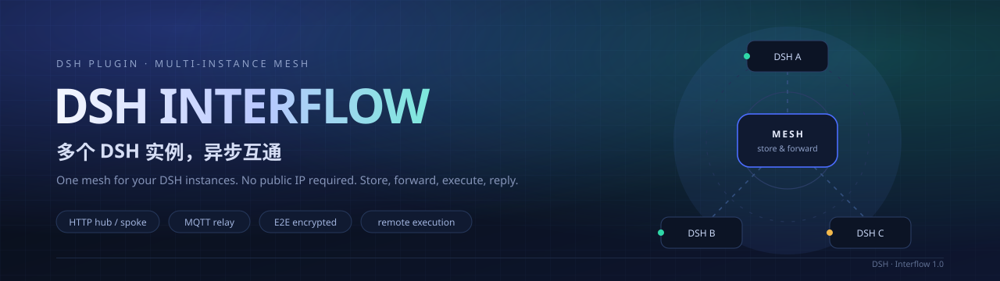
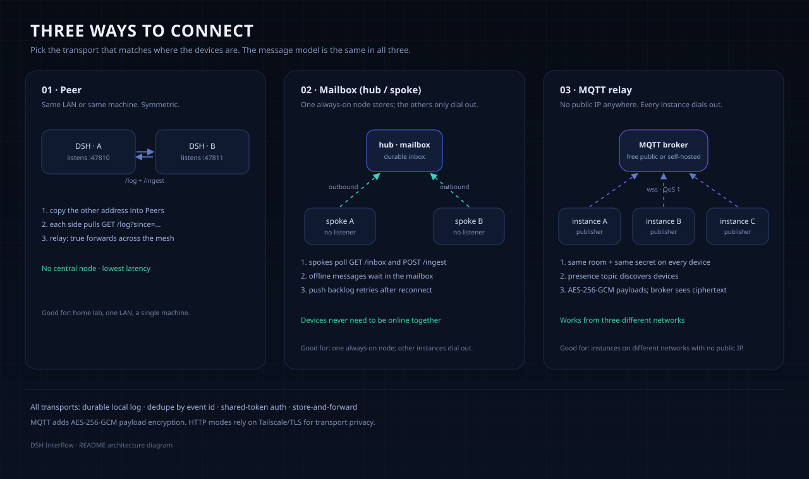
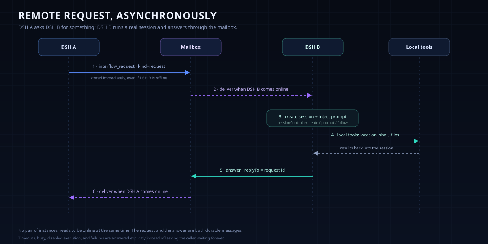

<p align="center">
  
</p>

<p align="center">
  
  
  
  
  
  <a href="https://github.com/wreckglow/dsh-data-interflow"></a>
</p>

# DSH Interflow · DSH 互通

**让多个 DSH 实例互相发消息、交接任务、远程执行并回传结果。**

它不是聊天软件，也不是又一个 IM 客户端。它是 **DSH 实例之间的协调层**：每个实例保留自己的会话、工作区、工具和权限，只把“要告诉谁什么”“请谁做什么”“结果是什么”这几件事交给 Interflow。

- **三种传输，按网络环境选**：同一局域网的对等模式、一个常开节点的信箱模式、跨网络无公网 IP 的 MQTT 中继。
- **异步**：消息先落盘，再投递；实例不需要同时在线，离线的一方上线后按游标补收。
- **人和 agent 共用一套动作**：面板能发的，工具也能发；工具能做的，面板也能做。
- **远程执行**：请求进入目标实例，建一个独立会话，调用它本地的工具，最后把结果作为回复投回来。

> 一句话：把“我在 A 上做完了，你去 B 上接着做”从复制粘贴变成一条可追踪的消息。

---

## 30 秒选择拓扑

| 你的情况 | 用哪种 | 需要什么 |
| --- | --- | --- |
| 同一台机器 / 同一局域网 | **Peer** | 一个端口和共享 token |
| 不在同一网络，但有一个常开节点 | **Mailbox（hub / spoke）** | 常开节点可达（Tailscale、隧道或公网） |
| 不在同一网络，且没有公网 IP、不想装组网工具 | **MQTT relay** | 一个免费 MQTT broker、同一个房间名和密钥 |
| 实例有时在线、有时离线 | 任意一种 | 都能离线补收；MQTT 取决于 broker 的会话持久化 |

没有公网 IP 不是问题：Mailbox 可以用 Tailscale/Cloudflare Tunnel/frp 把常开节点映射出来；MQTT 则让所有实例只做出站连接。



---

## 快速开始

### 1. 安装

在 DSH 里用插件管理器安装这个目录（绝对路径）：

```text
plugin_manager install_bundle  target: <这个目录的绝对路径>
```

安装后左侧栏会出现「互通」图标。若没有立即出现，刷新一次页面。

其他实例：把整个目录复制过去，在那边执行同样的安装。也可以直接从 GitHub 安装：

```text
plugin_manager install_bundle  target: github:wreckglow/dsh-data-interflow
```

发布与安装的完整步骤见 [docs/publishing.md](docs/publishing.md)。

MQTT 客户端已经打包为 `mqtt-bundle.cjs`，通过相对路径加载，**不需要目标机额外安装 `mqtt`**，也不经过 DSH 的裸包名解析器。只有安装目录里缺少这个 bundle 的旧版本，才需要回退安装依赖：

```bash
cd <插件目录>
pnpm install --prod --ignore-scripts
```

HTTP 模式完全不使用 `mqtt`。

### 2. 打开面板

左侧栏 →「互通」。面板包含：

- **顶部 Hero**：实例名、可复制的地址、传输状态、未读计数。
- **网络拓扑**：中心是本机，周围是已发现的实例；点击节点可设为发送目标。
- **消息流**：按时间排列，支持展开、回复、标记已读；请求会显示「等待回复 / 已回复」。
- **节点页**：发现/添加节点；包含 **MQTT 中继** 配置卡片。

### 3. 先验证连通

用任意一个实例的智能体调用：

```text
interflow_peers
```

它会返回本机角色、传输方式、地址，以及当前发现的节点。没有节点时，先按下面的“配置”把两个实例接起来。

---

## 三种传输

### Peer：同一局域网

每个实例监听一个端口，双方互相 `GET /log?since=…` 拉取，按事件 id 去重。适合同一台机器或同一个局域网。

```yaml
- id: dsh-interflow
  name: '@local/dsh-interflow'
  config:
    role: peer
    nodeName: node-a
    listenHost: 0.0.0.0
    listenPort: 47810
    token: change-me-shared-secret
```

在面板的「节点」页填入另一个实例的地址即可；`relay: true` 时消息可以被中间节点转发。

### Mailbox：一个常开节点当信箱

一个实例做 `hub`，其余做 `spoke`。spoke **不监听端口**，只主动推、主动拉；hub 保存每个成员的收件视图。实例不需要同时在线。

```yaml
# hub（常开节点）
role: hub
nodeName: node-a
listenHost: 0.0.0.0          # 或 Tailscale/ZeroTier 地址
listenPort: 47810
token: change-me-shared-secret
presenceWindowMs: 15000
```

```yaml
# spoke（其他实例）
role: spoke
nodeName: node-b
hubUrl: http://100.64.0.5:47810
token: change-me-shared-secret
pollMs: 15000
listen: false
```

hub 需要能被 spoke 连到。没有公网 IP 时用 Tailscale/ZeroTier，或用 Cloudflare Tunnel/frp 把 hub 映射出去。不要让 hub 直接以明文 HTTP 暴露在公网。

### MQTT：跨网络、无公网 IP

所有实例只做出站连接，连同一个 broker。broker 只看到主题和密文；消息用共享密钥派生的 AES-256-GCM 加密。实例通过 presence 主题自动发现彼此。

MQTT 客户端（`mqtt` 及其依赖）已打包为 `mqtt-bundle.cjs`，插件用 `import('./mqtt-bundle.cjs')` 加载。这样即使 DSH 的模块解析器不解析第三方裸包名（部分 Android/libnode 构建），MQTT 仍然可用；bundle 缺失时才回退到 npm 包。

```yaml
transport: mqtt
nodeName: node-a
mqttUrl: wss://broker.emqx.io:8084/mqtt
mqttTopic: interflow-<随机房间名>
token: change-me-shared-secret
executeRequests: true          # 只给需要被控制的实例
```

所有实例使用**同一个 `mqttTopic` 和同一个 `token`**，`nodeName` 各自唯一。也可以不改 YAML：打开「互通 → 节点」，在 **MQTT 中继（跨网络）** 卡片里填 Broker、房间名、共享密钥，点「启用 MQTT 中继」。切换会持久化到 `state.json`，重启后保留。

免费 broker 示例：

- `wss://broker.emqx.io:8084/mqtt`（已验证）
- `wss://broker.hivemq.com:8884/mqtt`
- `wss://test.mosquitto.org:8081/mqtt`

公开 broker 是共享的：房间名用长随机串，密钥用强随机值；对可靠性要求高就自建 Mosquitto/EMQX。公开 broker 不保证离线队列，长时间离线的实例可能错过消息。

---

## 远程执行

请求不是普通消息，它会触发目标实例上的一个真实 agent 会话。



流程：

1. 发起方用 `interflow_request` 工具或面板发送 `kind: request` 的**定向**消息。
2. 目标实例上线后取到请求，`sessionController.create()` 建独立会话，注入提示，跟随事件流。
3. 会话里的 agent 使用目标实例**本地**的工具、模型、沙箱和权限。
4. 第一个 `turn/end` 完成后，取最后一条 assistant 文本，作为 `kind: answer`、`replyTo = 请求 id` 的消息投回发起方。
5. 发起方下次上线收到答案；面板显示「等待回复 / 已回复」。

执行方需要显式开启：

```yaml
executeRequests: true
allowedRequesters: []          # 空 = 任何持 token 的已配对实例；也可填 nodeName
remoteCwd: /path/to/workdir    # 可选；省略用 DSH 默认工作区
requestTimeoutMs: 120000
maxRemoteRequests: 1
```

超时、忙、未开启执行、执行失败，都会回一条明确的 `answer`，不会让请求永远挂着。远程执行不绕过本机权限：危险操作仍受执行方的 permission/sandbox 约束；需要审批的工具调用可能因此超时。

### 执行审批

目标设备可以要求人工审批：

```yaml
executeRequests: true
requireApproval: true
```

也可以直接在「MQTT 中继」卡片勾选「执行前需要审批」。收到请求后不会自动运行，而是在「节点」页出现「待审批请求」；点「批准」才开始执行，点「拒绝」会回一条明确的 answer。

- 审批队列会持久化，重载后还在。
- `executeRequests: false` 时请求在进入审批前就会被拒绝。
- 审批是目标设备本地的决定，发起方无法绕过。
- 目前还没有每设备身份/scope；审批和共享 token 是两层不同的东西。

### 多目标任务

「节点」页的「多目标任务」卡片可以勾选多台设备（或「所有已知节点」），把同一段任务发给每台设备，并按设备汇总状态和回答。

智能体工具：

```text
interflow_run  targets: ["android","watch"]  subject: "检查"  body: "报告当前目录"
interflow_run  targets: ["*"]                subject: "检查"  body: "报告当前目录"
interflow_tasks
```

每个目标的状态是 `waiting / answered / timeout / error / cancelled`，任务整体是 `running / done / partial / failed`。答案异步回来，不会阻塞发送。任务卡片可以「取消等待」和「重试失败/超时目标」；取消只停止本地等待，不会中断远端已经开始的会话。

当前这版是 P0 编排：每个目标一个请求，没有文件附件；真正的文件/工作区数据要接 Syncthing/Git 或后续的分块传输。

---

## EMQX 文件库测试（B 方案）

如果你的 broker 是 EMQX，并启用了 **Management → File Transfer**，可以用 `verify-emqx-file.mjs` 先验证“上传到 EMQX，再通过 API 下载”这条路。

1. EMQX Dashboard → Management → File Transfer → Enable。
2. 选 Local Storage 或 S3 Storage。
3. System → API Keys 创建一个 **global** API key（namespaced key 不能下载文件）。
4. 设置环境变量（不要写进仓库）：

```powershell
$env:EMQX_MQTT_URL='mqtt://mysvip.fun:1883'
$env:EMQX_USERNAME='...'
$env:EMQX_PASSWORD='...'
$env:EMQX_API_URL='http://mysvip.fun:18083'
$env:EMQX_API_KEY='...'
$env:EMQX_API_SECRET='...'
node verify-emqx-file.mjs
```

脚本会：

- 用 MQTT 5 向 `$file/<id>/init`、`$file/<id>/<offset>`、`$file/<id>/fin/...` 上传；
- 调 `GET /api/v5/file_transfer/files` 找到文件；
- 下载 `uri`，校验 SHA-256。

预期最后输出：

```text
EMQX file transfer test OK
```

注意：EMQX File Transfer 是**上传到 broker 的文件库**，不是 A 直接发给 B。接收方要靠 EMQX REST API（Local）或 S3 预签名 URL（S3）下载；这一步跑通后，再把上传/下载接到插件工具里。

## 配置

配置写在实例 profile 的 `cordis.patch.yml` 里（插件管理器安装时写入的那一行）。面板可以修改传输方式；其余键通过 YAML 覆盖。

> 下面的 YAML 只展示 `config:` 里的键。完整行形如 `- id: dsh-interflow` / `name: '@local/dsh-interflow'` / `config: { ... }`。

### 通用键

| 键 | 默认 | 说明 |
| --- | --- | --- |
| `role` | `peer`（有 `hubUrl` 时为 `spoke`） | `peer` / `hub` / `spoke`；MQTT 模式忽略 |
| `transport` | `http` | `http` 或 `mqtt` |
| `nodeName` | `<主机名> (<profile>)` | 实例显示名，建议唯一 |
| `mainNode` | `false` | 设为主节点，向其他节点广播技能 |
| `sharedSkills` | `[]` | 额外广播的技能名；用于补充注册表里看不到的会话/preset 技能 |
| `token` | `''` | 共享令牌；为空时 HTTP 只接受本机回环节点，MQTT 必须有密钥 |
| `pollMs` | `2000` | 同步/轮询间隔（毫秒，最小 500） |
| `maxEvents` | `800` | 本机/信箱保留的消息条数（50–5000） |
| `dataDir` | `<DSH_HOME>/integrations/interflow/<profile>` | 状态目录 |

### HTTP 相关

| 键 | 默认 | 说明 |
| --- | --- | --- |
| `listen` | `true`（spoke/MQTT 默认 `false`） | 是否监听入站端口 |
| `listenHost` | `127.0.0.1` | 绑定地址；跨机用 `0.0.0.0` 或组网地址 |
| `listenPort` | `47810` | 起始端口；被占用时顺延最多 20 个 |
| `hubUrl` | `''` | spoke 的信箱地址 |
| `hubToken` | `''` | 单独给信箱的令牌；为空用 `token` |
| `presenceWindowMs` | `15000` | hub 判断成员在线的窗口 |
| `peers` | `[]` | 对等模式的初始节点列表 |
| `relay` | `true` | 对等模式下是否中转转发 |

### MQTT 相关

| 键 | 默认 | 说明 |
| --- | --- | --- |
| `mqttUrl` | `''` | broker，如 `wss://broker.emqx.io:8084/mqtt` |
| `mqttTopic` | `''` | 房间名，所有实例一致 |
| `mqttUsername` / `mqttPassword` | `''` | 可选 broker 账号 |
| `mqttSecret` | `''` | 单独的端到端密钥；为空用 `token` |

### 远程执行相关

| 键 | 默认 | 说明 |
| --- | --- | --- |
| `executeRequests` | `false` | 是否执行收到的请求 |
| `requireApproval` | `false` | 收到的请求先进入待审批，人工批准后才执行 |
| `allowedRequesters` | `[]` | 允许发起请求的 nodeName/nodeId；空 = 任何已鉴权实例 |
| `remoteCwd` | `''` | 请求会话的工作目录 |
| `requestTimeoutMs` | `120000` | 单次执行超时（5000–1800000） |
| `maxRemoteRequests` | `1` | 同时执行的请求数（1–4） |

---

## 在聊天里直接用

插件在 Host 注册了工具和一个 `interflow` skill，新建会话后不需要打开面板，直接对智能体说：

- “看看互通里现在有哪些节点、谁在线。”
- “给 android 发一条消息：构建完成了。”
- “问一下 android 现在在不在，等它回答。”
- “让所有在线节点报告当前目录，把结果汇总给我。”
- “看看互通收件箱里有没有新消息。”
- “让主节点用 agent-experience 技能处理这个任务。”

智能体会自己调用 `interflow_peers`、`interflow_send`、`interflow_request`、`interflow_run`、`interflow_tasks`、`interflow_inbox` 等工具。已有会话如果还没有这个 skill，开一个新会话或刷新页面。

面板仍然保留，用来配置传输、看拓扑、审批请求和任务结果；日常使用可以完全在聊天里完成。

## 智能体工具

| 工具 | 用途 |
| --- | --- |
| `interflow_send` | 发消息；`to` 可以是实例名/id/URL，或 `*` 广播 |
| `interflow_ask` | 给一个实例发任务并**在同一轮聊天里等回答**，适合问答/快速任务 |
| `interflow_request` | 请一个实例执行任务并回传结果；必须指定单个目标 |
| `interflow_run` | 同一任务发给多个目标；`targets: ["*"]` 表示所有已知节点 |
| `interflow_tasks` | 查看多目标任务及每个目标的回答状态 |
| `interflow_retry` | 重试任务里失败/超时/取消的目标 |
| `interflow_cancel` | 取消任务的本地等待；不中断远端已开始的会话 |
| `interflow_inbox` | 读收件箱；可只读未读、按来源过滤、用 id 读全文 |
| `interflow_peers` | 查看本机角色、传输、地址、发现的节点和在线状态 |
| `interflow_connect` | 对等模式下按 URL 添加/移除节点 |

工具输出是 JSON，错误带稳定的 `code`，例如 `no_peers`、`unknown_peer`、`request_target_required`、`invalid_mqtt_url`。

---

## 主节点技能

可以把一个实例设成主节点，把它的技能目录广播给其他节点；其他节点在「节点」页看到「主节点能力」，点「委派」即可让主节点用本地技能执行。

主节点配置：

```yaml
mainNode: true
executeRequests: true
sharedSkills:
  - agent-experience
  - cordis-plugin-development
```

- `mainNode: true` 让 presence/health 带上主节点标记和技能名。
- 技能目录来自 Host 的技能注册表；会话/preset 作用域的技能如果不在全局注册表里，用 `sharedSkills` 手动列出名字。
- 其他节点只拿到技能名，不复制技能文件，也不接触主节点的 MCP 或密钥。
- 委派会发一条 `执行请求` 给主节点；主节点的 agent 用本地技能执行，结果回到消息流。
- 主节点必须开 `executeRequests: true`，否则会回一条“未开启执行”。

MCP 不参与这套目录；MCP 仍只在主节点本地，通过远程执行间接使用。

## 安全

- 默认只绑定 `127.0.0.1`；非回环绑定必须设置 `token`。
- HTTP 模式本身不加密传输：跨公网请走 Tailscale/WireGuard 或 TLS 隧道/反代。
- MQTT 模式对消息体做 AES-256-GCM 加密；broker 只看到主题、时间和大小。房间名和密钥仍然要保密。
- 公开 broker 是共享环境；重要数据用自建 broker，或改用 HTTP 信箱。
- 远程执行默认关闭；需要时再开，并用 `allowedRequesters` 限定来源。
- 令牌和 MQTT 密钥以明文保存在 `state.json` 和 `cordis.patch.yml`，按文件权限保护。
- 消息正文最多 16000 字符，单次 HTTP 请求 256 KiB。

---

## 常见问题

**没有公网 IP 怎么办？**
三条路：用 Tailscale/ZeroTier 把实例组网；用 Cloudflare Tunnel/frp 把常开节点映射出去；或者直接上 MQTT 中继。都不需要公网 IP。

**实例在不同网络、也不能装组网工具？**
优先 MQTT。所有实例只出站，连一个 free broker，房间名和密钥一致即可。

**面板没有变化？**
客户端 bundle 需要刷新。刷新页面，或切走再切回「互通」。MQTT 配置卡片在「节点」页。

**MQTT 连接报缺少 `mqtt` 或 bundle 加载失败？**
当前包内置 `mqtt-bundle.cjs`，正常情况下不需要额外安装。先确认安装目录里这个文件存在；旧版本可以执行 `pnpm install --prod --ignore-scripts` 回退到 npm 包。两者都失败时，把完整 `error.stack` 发出来，不要继续改 `node_modules`。

**启用 MQTT 报 “A shared secret is required”？**
面板里的「共享密钥」是 Interflow 的端到端加密密钥，**不是 broker 密码**；当前 profile 如果也没有 `token`，就必须填一个。三台设备填同一个强随机值。Broker 的用户名/密码是另一组可选字段。

**Broker 地址该写 `mqtt://` 还是 `ws://`？**
纯 TCP MQTT 用 `mqtt://host:1883`（不要带 `/mqtt` 路径）；WebSocket 用 `ws://host:8083/mqtt` 或 `wss://host:8084/mqtt`；TLS TCP 用 `mqtts://host:8883`。`/mqtt` 是 WebSocket listener 的路径，不是 TCP 的。

**公开 broker 可靠吗？**
只适合试用和小流量。它不保证离线队列、retained 消息和限流。稳定使用请自建 Mosquitto/EMQX。

**节点显示 401 / forbidden？**
两边的 `token` 不一致，或对端监听在非回环地址但没有 token。

**远程执行没有返回？**
确认目标实例 `executeRequests: true`、来源在 `allowedRequesters` 内；如果请求需要审批，目标实例可能一直等到超时。超时会回一条失败说明。

**端口被占用？**
`listenPort` 只指定起始端口，插件会顺延最多 20 个；面板顶部显示实际地址。

**消息会重复吗？**
会以至少一次投递；按事件 `id` 去重。顺序按每个实例的日志序号，不依赖设备时钟。

**为什么没有 Telegram/Matrix 适配器？**
这次先做了 MQTT（更通用、无账号依赖）。IM 适配器在路线图里，需要基于 `dsh-im` 的消息模型另做一层。

---

## 验证

四个不依赖 DSH 的测试脚本：

```bash
node verify-host.mjs        # 对等模式：工具、推送、拉取、面板路由、传输切换
node verify-mailbox.mjs     # 信箱模式：hub + 两 spoke、离线补收、远程请求
node verify-mqtt.mjs        # MQTT 适配器：内存 broker 下的加密、路由、presence
node verify-client.mjs      # 浏览器半渲染：多种页面状态、全部词典键
```

需要外网的真实 broker 测试：

```bash
node verify-mqtt-live.mjs    # broker 连通性
node verify-mqtt-engine.mjs  # 两个真实引擎经公共 broker 互发 + 远程请求
```

已验证：

- 信箱模式：广播、定向回复、成员隔离、离线消息补收、重连补取。
- 远程执行：请求 → 建会话 → 注入 → 跟随 → 回传；未开启执行会明确拒绝。
- MQTT：真实公共 broker 上完成发现、直发、回复、远程请求；内存 broker 上验证密文和离线 presence。
- 面板：侧栏/主面板 slot 激活；多角色、MQTT、空状态等渲染路径通过。

**未在测试中执行真实模型调用**：远程执行链路使用 fake `sessionController` 验证，避免产生会话和费用。首次在生产实例启用时，建议先发一个“只回复 OK”的请求确认。

---

## 目录

```text
index.js              Host 半：角色、传输、同步、持久化、工具、面板路由
mqtt-transport.js     MQTT 适配器：加密、主题、presence
mqtt-bundle.cjs       内嵌 mqtt 及其依赖，相对路径加载
client.js             浏览器半：侧栏入口、面板、消息流、MQTT 配置
cordis.patch.yml      插件行与配置注释
locale/{zh,en}.json   插件管理器显示用的标题与描述
icon.svg              插件图标
assets/*.svg          README 插图
verify-*.mjs          自测脚本
```

## 开发

```bash
pnpm install --prod --ignore-scripts
node verify-host.mjs
node verify-mailbox.mjs
node verify-mqtt.mjs
node verify-client.mjs
```

重新生成 MQTT bundle（升级 `mqtt` 后）：

```bash
pnpm dlx esbuild@0.25.0 node_modules/mqtt/build/index.js \
  --bundle --platform=node --format=cjs --target=node20 \
  --outfile=mqtt-bundle.cjs --conditions=node \
  --external:bufferutil --external:utf-8-validate
```

面板协议：Host 在 `/api/interflow` 上处理 `snapshot` / `send` / `addPeer` / `removePeer` / `markRead` / `sync` / `configureTransport`，浏览器用同源 Cookie 访问。节点间 HTTP 协议：`GET /health`、`GET /log`、`GET /inbox`、`POST /ingest`。

README 里的插图是仓库内的 SVG。想换成 818 生成的位图，见 [docs/818-prompts.md](docs/818-prompts.md)。

## 路线图

- IM 适配器（Telegram / Matrix），复用 `dsh-im` 的账号与消息模型。
- 远程执行的审批 UI（按来源、按工具、按目录）。
- 更紧凑的窄屏布局与未读通知。
- 附件/图片的跨实例传递。
- 每个请求可指定模型或 agent preset。

---

<p align="center">
  <sub>DSH Interflow · 私有插件（package.json <code>private: true</code>）· 图标与插图为原创</sub>
</p>
